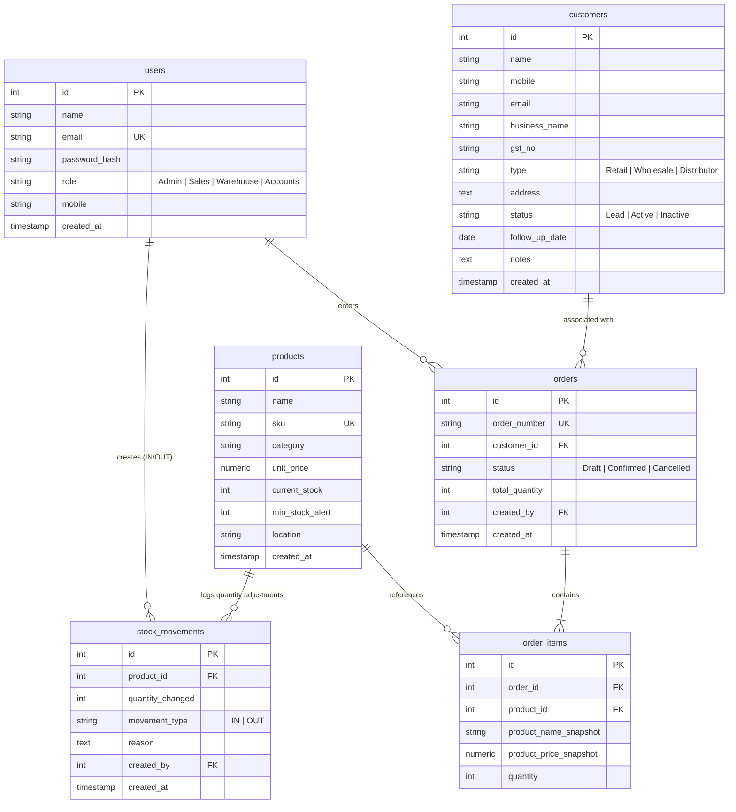

# Mini ERP + CRM Operations Portal
## Professional Technical & Architectural Documentation
*Prepared for Company Presentation*

---

## 1. Executive Summary & Overview

The **Mini ERP + CRM Operations Portal** is a high-performance, responsive web application designed for wholesale and distribution enterprises. The system integrates customer relationship management (CRM) workflows with basic enterprise resource planning (ERP) functions, including product inventories, live stock movement tracking, and automated transactional sales order dispatch. 

### Core Value Proposition:
* **End-to-End Traceability:** Connects customer accounts to transactional order items, with automated stock movement logs for auditable record keeping.
* **Role-Protected Operations:** Enhances data integrity by restricting critical inventory edits, financial operations, and order states to qualified corporate roles.
* **Resilient Infrastructure:** Features a hybrid database engine utilizing raw PostgreSQL in production and a zero-config, in-memory SQLite/Postgres emulator (`pg-mem`) for developer isolation and rapid testing.
* **High-End UI/UX:** Built with a premium, responsive glassmorphism theme powered by React and a hardware-accelerated 3D space background rendered using Three.js.

---

## 2. System Architecture & Flow

The application follows a decoupled client-server architecture with a clear division of concerns. The backend is modularly structured, separating route handling, request validation, business logic, database queries, and response compilation.

### Component Topology
```mermaid
graph TD
    subgraph Client Layer (React 18 + TS)
        UI[Glassmorphism UI] --> Context[AuthContext]
        UI --> Three[Three.js Galaxy Background]
        UI --> Client[Axios API Client]
      end

      subgraph Routing & Gateway (Netlify/Nginx)
        Client --> Gateway{/api/* Route Gateway}
      end

      subgraph Application Server (Node.js + TS)
        Gateway --> Routes[Express Routers]
        Routes --> Mid[Middlewares: Auth & Zod Validator]
        Mid --> Control[Controllers]
        Control --> Service[Services: Business Logic]
      end

      subgraph Data Store Layer
        Service --> DBProxy{db.ts Connection Pool Proxy}
        DBProxy -->|Prod: TCP/IP Connection| Postgres[(PostgreSQL 15)]
        DBProxy -->|Local Fallback: In-Memory| PgMem[(pg-mem Engine)]
      end
```

### Modular Design Pattern
Each backend feature (e.g., `customers`, `products`, `orders`) is contained within its own directory in `backend/src/modules/` containing:
1. `router.ts`: Exposes public/private endpoints and wires up specific role-check middleware.
2. `schema.ts`: Defines runtime request payload validation rules using **Zod** models.
3. `controller.ts`: Extracts query/request parameters, invokes service actions, and maps output models.
4. `service.ts`: Executes core SQL operations, coordinates transactions, and enforces business rules.

---

## 3. Database Design & Entity Relationship

The database schema utilizes six tables configured with appropriate constraints (uniqueness, check constraints, foreign keys) to ensure structural integrity.

### Entity-Relationship Diagram (ERD)


---

## 4. Key Workflows & Code Execution Patterns

### A. Atomic Stock Deduction Transaction
To prevent partial orders or double-spending, order confirmation initiates a transactional workflow on the database. If any step fails (e.g., stock levels drop below the requested amount), the database rolls back all operations safely.

```
[Create Order OrderRequest]
        │
        ▼
   [Start Transaction: BEGIN]
        │
        ▼
   [Lock & Fetch Product Stock Levels]
        │
        ├─► [Insufficient Stock?] ──► [Rollback: ROLLBACK & Throw Error]
        │
        ▼
   [Deduct Current Stock in Products Table]
        │
        ▼
   [Create Stock Movement Audit Log (OUT)]
        │
        ▼
   [Insert Order Records & Snapshots]
        │
        ▼
   [Commit Transaction: COMMIT]
```

### B. In-Memory Database Fallback Handler
The database interface `backend/src/config/db.ts` exposes a smart initialization routine. This handles situations where PostgreSQL is missing, ensuring high availability:

```typescript
const client = await pgPool.connect();
// If connection succeeds, proxy all queries to the real PostgreSQL pool.
// If connection throws (e.g., pg server not running), boot in-memory database:
const activePool = newDb().adapters.createPg().Pool;
await seed(activePool);
```

---

## 5. UI/UX & Styling Design System

The application's interface presents a responsive, immersive design styled using **Vanilla CSS Variables** to build a modern dark-mode glassmorphic interface.

### Style System Attributes:
* **Background Canvas:** A custom Three.js engine rendering a slow-spinning, three-arm spiral galaxy surrounded by floating neon nebulas, background stars, and animated shooting stars.
* **Parallax Motion:** Mouse position event listeners map subtle offsets to the camera coordinates, creating a dynamic sense of depth.
* **Glassmorphism Theme:** Cards use `backdrop-filter: blur(12px)` combined with semi-transparent borders `border: 1px solid rgba(255, 255, 255, 0.08)` to mimic a sleek frosted glass overlay.
* **Visual Status Indicators:** Badges (e.g., `Draft`, `Confirmed`, `Cancelled`, `Low Stock`) utilize pulse animations and tailored status colors to alert managers immediately.

---

## 6. API Endpoint Inventory

All protected routes require an HTTP request header: `Authorization: Bearer <JWT_TOKEN>`.

| Method | Endpoint | Allowed Roles | Description |
| :--- | :--- | :--- | :--- |
| **POST** | `/api/auth/login` | Public | Authenticate user credentials and return JWT token. |
| **GET** | `/api/auth/me` | All Roles | Retrieve current user profile from token context. |
| **GET** | `/api/customers` | Admin, Sales, Accounts | Paginated listing of customer records with filters. |
| **POST** | `/api/customers` | Admin, Sales | Create a new customer profile. |
| **POST** | `/api/customers/:id/notes`| Admin, Sales | Append a follow-up action note to notes history. |
| **GET** | `/api/products` | All Roles | View entire product catalog list. |
| **POST** | `/api/products` | Admin, Warehouse | Create SKU-validated inventory catalog items. |
| **POST** | `/api/stock/movement` | Admin, Warehouse | Record manual stock additions/deductions. |
| **POST** | `/api/orders` | Admin, Sales | Create sales order drafts or confirm orders. |
| **PUT** | `/api/orders/:id/status` | Admin, Sales | Advance order state (`Confirmed` / `Cancelled`). |

---

## 7. Local Setup & Configuration Guide

### 1. Configure Environments
Copy the environment template files in both directory roots:
```bash
cp backend/.env.example backend/.env
cp frontend/.env.example frontend/.env
```

### 2. Install Project Dependencies
Run install script on both layers:
```bash
# Install backend
cd backend
npm install

# Install frontend
cd ../frontend
npm install
```

### 3. Run Dev Server
Launch servers simultaneously (run in separate terminals):
```bash
# Start backend (Port 5000)
cd backend
npm run dev

# Start frontend (Port 5173)
cd frontend
npm run dev
```

---

## 8. Enterprise Deployment Architecture (Netlify Monorepo)

The repository configures **Netlify** to compile and serve both the static React client and the serverless Express API handler dynamically.

### Build Configuration (`netlify.toml`):
* **Build Command:** `npm install && cd frontend && npm install && npm run build`
* **Publish Directory:** `frontend/dist`
* **Functions Directory:** `netlify/functions`

### Rewrite Mapping:
All `/api/*` requests target the compiled serverless handler wrapper `netlify/functions/api.ts` which boots up the Express instance, handles routes, and wraps standard Node HTTP requests.
